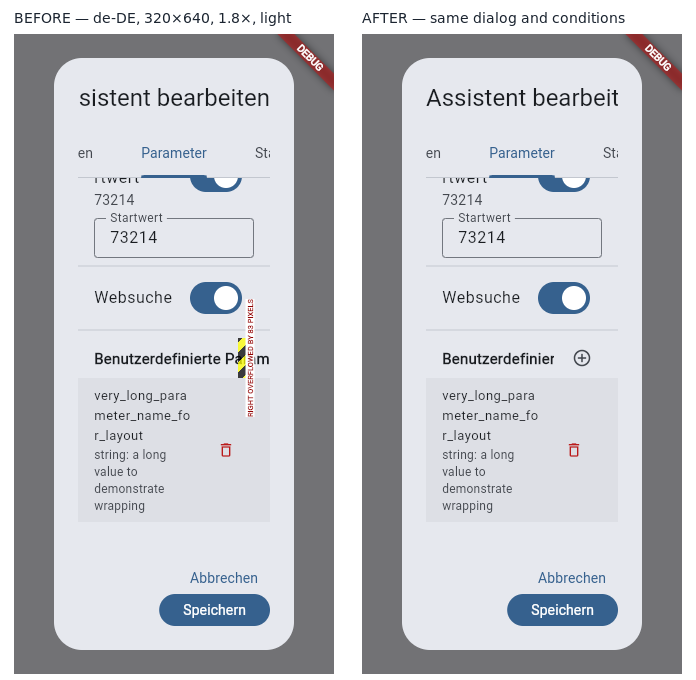

# Assistant panel redesign — design QA

- **Selected direction:** generated design option 3.
- **Implementation:** `lib/pages/assistant/built_in_prompt_selector.dart`, using the real selector widget and existing import flow.
- **Reference comparison:** [selected option 3 beside the rendered implementation](docs/images/assistant-market-option3-qa.png). The reference is scaled to 393 × 630 for comparison; the implementation capture is a real Flutter Web rendering at 393 × 630.
- **States checked:** Built-in tab, Import tab, existing remote catalog/file dialog opened from Import, dark theme, and 320 × 640 narrow viewport.
- **Interactions checked:** switching source tabs, back arrow returning from Import to Built-in, and Import action opening the existing remote source dialog. Flutter widget tests cover existing info/detail/add behavior and dismissal.
- **Visual findings:** the Built-in and Import choices read as peer actions; list rows retain name, description, info, and Add affordances at narrow widths; typography and surfaces follow the active Material color scheme in both light and dark themes. The representative capture shows only the panel content.
- **Runtime:** no browser page errors during captures. Existing WebAssembly dry-run warning about `get_thumbnail_video` using `dart:html` is unrelated to this change.
- **Result:** passed for the checked states.

## Assistant edit dialog — parameter heading

- **Surface and method:** the real `showAssistantFullEditDialog` and `_buildEditParamsTab` rendered in Chromium from the audit entrypoint; system fonts loaded from the Flutter web build. The temporary entrypoint and initial-tab selector were removed after capture.
- **Before:** at 320 × 640 CSS px, de-DE, 1.8× text scale, light theme, the `Benutzerdefinierte Parameter` heading overran its finite `Row` by 8.3 px beside the add action. The capture shows Flutter’s red overflow marker.
- **After:** the same dialog data, locale, viewport, scale, theme and scroll position. The heading gets all remaining row width after a fixed 8 px gap, stays on one line at 15 px / 600 weight, and uses the shared `ConstrainedText` horizontal reveal only when needed; the add action remains at the trailing edge and semantics retain the full translated label. No translation, font size, or editable field changed.
- **Other tab content checked:** the long assistant override helper and enabled SwitchListTile labels remained readable; seed label/value fields were not clipped; long custom parameter name and value wrapped naturally. pt-BR dark theme wrapped `Pesquisa na web`; Arabic dark theme used RTL alignment and kept the controls visible. The change does not touch an editable value field, so keyboard/caret behavior is unchanged.
- **Motion:** the component waits 1 s before moving at 24 logical px/s and holds 2 s at each endpoint before reversing. The 16.12 s WebM spans a full prefix-to-suffix reveal and the trailing-end hold. Start endpoint is offset 0 (leading text); end endpoint is offset −overflow (trailing text).

Matched comparison, de-DE light, 320 × 640 CSS px at 1.8× text scale:

Endpoint and locale verification captures: [after tail endpoint](docs/images/assistant-param-after-endpoint.png), [English at 1×](docs/images/assistant-param-after-en-1x.png), [pt-BR dark](docs/images/assistant-param-after-pt-dark.png) and [Arabic dark / RTL](docs/images/assistant-param-after-ar-dark.png). The shorter English label uses the same reveal at the narrow size; no locale branch was added. [Play the 16.12 s heading reveal preview](docs/videos/assistant-param-heading-motion.webm).

## Anki deck statistics — bounded chips

- **Fixture:** the production `AnkiDroidPage` rendered in Flutter Web with a provider override for one deck named “A very long deck name for a narrow screen”; statistics are 123456 new, 987654 learning, and 456789 review cards. The Spanish locale supplies the longer “Aprendiendo” statistic label. The temporary capture entrypoint was removed after recording.
- **Viewport and scale:** 320 × 640 CSS px, DPR 1, and normal 1× Flutter text scaling for both browser artifacts. No browser text zoom or app text-scale override was applied. The deck card remains tappable, its statistic row fits without a render overflow, and each count and translated label stays intact through the shared measured reveal. The separate widget tests exercise the narrow layout at 1.8× text scale and study title/navigation at 1.25×.
- **Interaction:** the playable preview shows the statistic labels revealing their clipped content and the deck card opening the study page; the whiteboard toolbar action remains visible. No browser page errors occurred.
- **Artifacts:** [320 × 640 deck-card capture](docs/images/anki-bounded-stats-320x640.png) and [playable Flutter Web preview](docs/videos/anki-bounded-stats-preview.webm).

## Anki study empty-state — high text-scale overflow follow-up

- **Reproduction:** start with an Anki deck whose next-card query returns no card. Set the app locale to Spanish, viewport to 320 × 640 CSS px, DPR to 1, and Flutter text scale to 1.8×. Open the deck from `AnkiDroidPage` so `AnkiStudyPage` enters its no-cards state.
- **Observed result:** Flutter reports `A RenderFlex overflowed by 142 pixels on the bottom` while `_buildDone` lays out the celebration icon, wrapped empty-state copy, and Back button. This was observed in the widget test while checking the scaled study title. The empty-state layout needs its own fix and a regression test.
