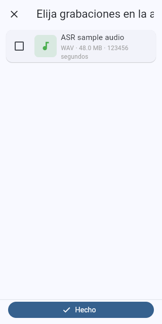

# ASR picker metadata reflow



This is a screenshot of the production `AsrPage` and its in-app audio picker. At
320 × 640 CSS pixels, the device scale factor is 1, locale is Spanish (`es-ES`),
the Material 3 theme is light, text scale is 1×, focus is none, and the keyboard
is closed. The visible row keeps the complete format, file size, and localized
duration; the duration wraps to a second line in the finite-width file-info
column.

The QA entrypoint registers one synthetic `AudioRecord` in the in-memory
manifest and never creates audio bytes, reads an audio file, calls a provider, or
accesses a network service. Nothing is selected in the picker. The long sample
duration is only metadata to make the wrap visible.

Reproduce from the repository root:

```sh
flutter build web --release --no-pub --target tool/qa/asr_metadata_reflow_capture.dart --output /tmp/stroom-asr-metadata-web --no-wasm-dry-run
python3 tool/qa/asr_metadata_reflow_capture.py
```

The capture script serves that local release build and uses Chromium at the
same viewport and device scale. This change does not alter motion, so a motion
preview does not apply.
