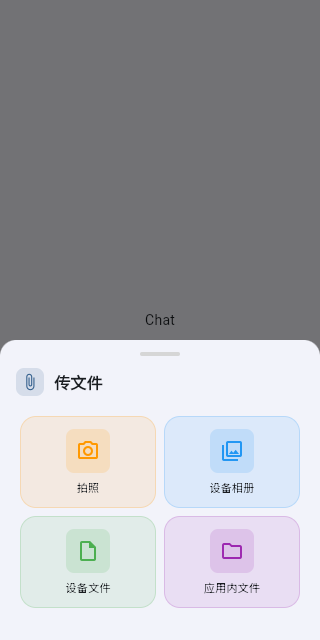

# Chat attachment panel reflow

This capture renders Stroom's production `showChatAttachmentPanel` sheet in
Flutter Web at a 320 × 640 logical-pixel viewport and 1× device pixel ratio.
It uses the `zh_CN` locale, light theme, and the normal 1.0 text scale. No
control is focused and the software keyboard is closed; the sheet contains no
editable fields. The four actions are all visible in a two-column layout.

The capture harness opens the production sheet directly and uses no file or
camera fixtures. No animation changed, so a motion preview is not applicable.
