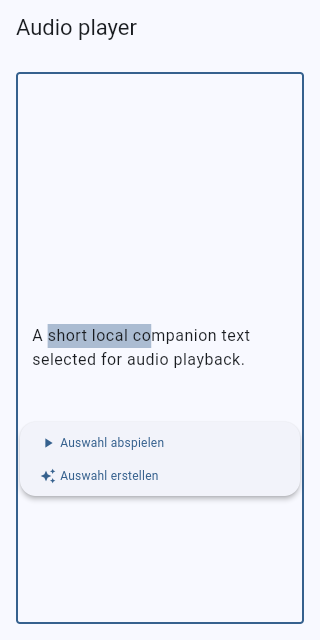

# Audio text selection toolbar



The capture shows the production `AudioPlayerSelectionToolbar` and its
`AudioPlayerToolbarButton` actions in German (`de-DE`), with the blue-seeded
Material 3 light theme, a 320 × 640 CSS-pixel viewport, 1× device scale, and
normal text scale. It uses a local synthetic companion-text fixture; no audio,
provider, or external data is loaded. The native read-only text field is focused
with a short range selected. Because it is read-only, no software keyboard is
shown. The action callbacks are inert in this visual fixture.

The two full German action labels wrap onto separate rows while retaining their
icons and touch targets. No motion is part of this toolbar, so a playable preview
does not apply. `tool/qa/audio_selection_toolbar_capture.dart` is the capture
entrypoint. Reproduce the image with:

```sh
flutter build web --release --no-pub --target tool/qa/audio_selection_toolbar_capture.dart --output /tmp/stroom-audio-selection-web --no-wasm-dry-run
```

Serve the output locally and capture it at 320 × 640 with device scale factor 1.
The focused widget tests cover narrow German labels in both light and dark
themes and the existing wide single-row appearance.
