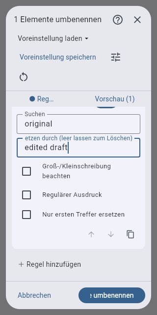

# Batch rename field-label reveal

[Play the clipped field-label reveal](clipped-field-label-motion.webm)

The screenshot and 12.3-second WebM capture the production `BatchRenameDialog` and `BatchRenameRuleEditor` using a release Flutter Web build in headless Chromium. The viewport is 320 × 640 CSS pixels at device scale 1, with German (`de-DE`), the blue-seeded Material 3 light theme, and normal 1× text. The rule pane is scrolled to its enabled replace rule. Its localized replace label clips in the native field slot and moves inside that slot; the typed value stays stationary.

The screenshot shows the replace field focused with `edited draft` entered and the caret at the end. Headless Chromium does not display a mobile software keyboard. The focused-field widget test separately verifies the field keeps focus, its value, and a non-end selection while the label moves. The same test checks a fitting English field label stays stationary at a wider viewport.

The capture uses one local demo file and a replace rule (`original` → `updated`) to show a realistic preview; it does not access app data or network services. Browser page and console errors were not reported; see [browser-errors.txt](browser-errors.txt).
