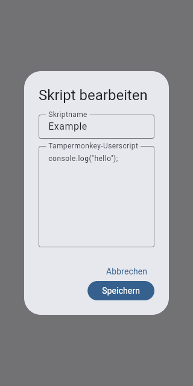
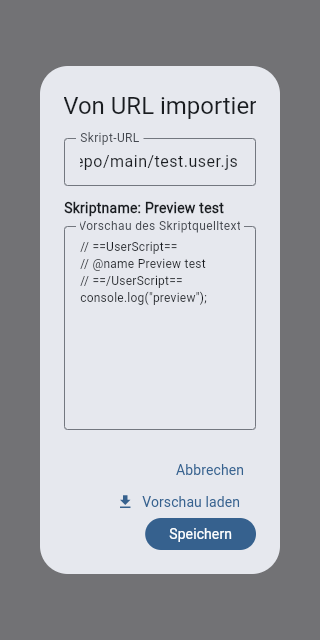

# Browser userscript forms

The browser's manual userscript editor and URL import dialog keep their localized
field labels inside finite input slots. Editable name, source, and URL values
remain native text fields, and the fetched source remains selectable wrapping
content.

- 
- 
- [Manual editor label reveal at 320 × 640, 1.5× text](userscript-manual-de-label-reveal-320x640-1_5x.webm)

The screenshots and motion preview use the production dialogs through
`tool/qa/bounded_browser_script_capture.dart`, built with Flutter 3.47.9 and
Dart 3.13.7 and rendered in headless Chromium at a 320 × 640 CSS viewport and
device pixel ratio 1. The fixture uses German labels and a local userscript
sample; its fetch callback returns in-memory source and makes no external
request. The motion preview uses 1.5× text scaling to show the clipped editor
labels moving while the input fields remain editable.

`tests/pages/browser_user_scripts_test.dart` covers the editor at 320 × 640 with
French localization and 1.5× text scaling, focused text editing and save, local
HTTPS URL validation without a fetch, the import loading state, a selectable
mocked preview and save, and cancellation.
