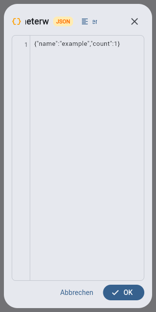
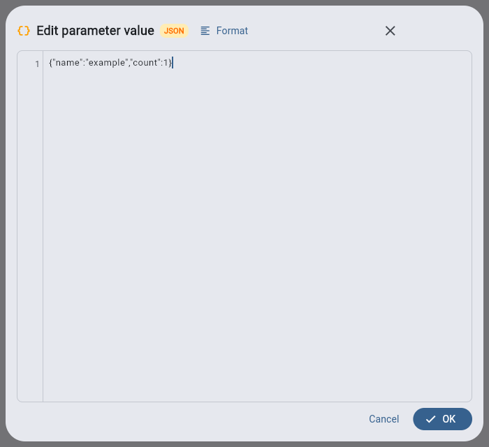

# Bounded code editor dialog heading

The shared production JSON value editor keeps its localized title in a measured finite slot. Its JSON badge, format action, and close action remain visible at narrow widths.

- 
- [German title reveal at 320 × 640, 1×](code-editor-dialog-de-title-reveal-320x640-1x.webm)
- 
- [English fitting title remains stationary at 700 × 640, 1×](code-editor-dialog-en-fitting-700x640-1x.webm)

Captures use `tool/qa/bounded_code_dialog_capture.dart`, a temporary fixture entrypoint that opens the actual `showJsonValueEditorDialog` with local sample JSON; it makes no provider requests or saves external data. The fixture selects German by default and accepts `?locale=en` for the fitting English example. Flutter Web ran in Chromium with a 1× device scale factor, normal text scale, and the light theme. The narrow capture opens the dialog at 320 × 640; the wide capture opens it at 700 × 640. The narrow video shows the long German title and format label revealing clipped text while controls remain available; the English title fits and does not move.

The widget suite covers German at 320 × 640 in light and dark themes, checks the title, JSON badge, format action, and close control without a layout exception, checks the English fitting title's badge alignment and stationary behavior, and exercises keyboard editing, formatting, save, and close behavior.
