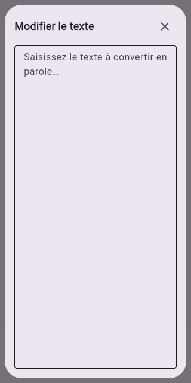

# Bounded TTS fullscreen editor title

The fullscreen TTS text editor keeps its localized title in the available
header width and preserves the close action at the trailing edge. The dialog
continues to use the native multiline `TextField` for editing.

- 
- [French title reveal at 320 × 640, 1× device scale and 2× text scale](tts-editor-title-reveal-320x640-2x.webm)

These captures show the actual `TTSCreatePage` fullscreen dialog, opened from
the production text field. `tool/qa/bounded_tts_editor_capture.dart` provides a
local TTS model fixture; it makes no provider requests and does not synthesize
or save audio. The default fixture uses French, the light theme, normal text
scale, a 320 × 640 viewport, and a 1× device scale factor. Add `?scale=1.6` to
`?scale=2.0` exercises the clipped title reveal. The widget test also checks a fitting English
title at 700 × 640 and verifies typing in the dialog remains in the page field
after closing it.
