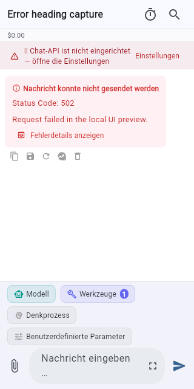

# Chat send error heading preview

The screenshot shows the production `ChatPage` error bubble at a narrow viewport. The playable preview isolates its production icon row and `ConstrainedText` label so the clipped motion is easy to inspect.

[Play the clipped heading preview](chat-send-error-heading-320x640-1x-light.mp4)

## Capture state

- Logical viewport: 320 × 640 dp
- Device pixel ratio: 1
- Text scale: 1.0
- Theme: light
- Locale: German (`de_DE`)
- Focus: no control focused
- Keyboard: hidden
- Screenshot: real Flutter web capture of the production page and German translation
- Video: real Flutter web frames of the production row sizing and constrained-text behavior, showing the initial still period and the clipped heading moving
- Test-only content: the video uses a longer German heading to force clipping; the screenshot uses local assistant error details with HTTP status 502. No network or provider request is made.

The production screenshot route is [`tool/qa/chat_error_heading_capture.dart`](../../../tool/qa/chat_error_heading_capture.dart). The focused animated preview is [`tool/qa/chat_error_heading_label_preview.dart`](../../../tool/qa/chat_error_heading_label_preview.dart).
