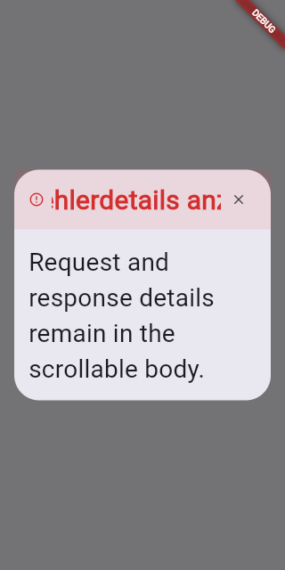

# OCR and ASR error details header QA

The screenshot and motion preview render the production `ErrorDetailDialogHeader` used by both OCR and ASR error detail dialogs. The body in the temporary Flutter Web capture harness is placeholder copy; the production request and response content remains in each dialog's existing scrollable list.

- Chromium, Flutter Web, German locale, 320 × 640 CSS viewport, device scale factor 1, 2× text scale.
- The title is longer than the space left between the error icon and close control. It keeps the current 15 px/600 styling and moves only inside its bounded slot. The close control remains visible and clickable.
- The preview is an 18.8 second recording of the rendered header motion, including its initial pause and bidirectional reveal.

[Play the header motion preview](asr-error-details-motion-preview.webm)

`tests/pages/content/ocr_error_details_header_test.dart` checks both localized labels, the 320 × 640/2× rendering, the fixed error icon and close action, and dialog dismissal. It passed with `flutter test --no-pub tests/pages/content/ocr_error_details_header_test.dart --reporter expanded`.
