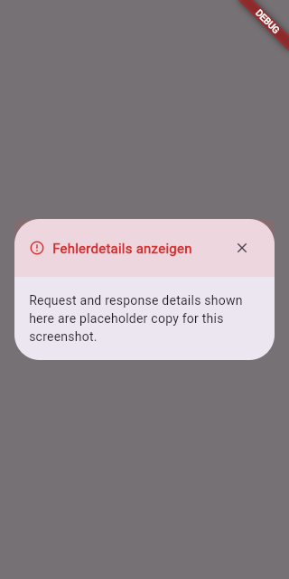

# OCR and ASR error details header QA

## Primary acceptance capture

This Chromium capture shows the production `ErrorDetailDialogHeader` used by both OCR and ASR error-detail dialogs in German at a 320 × 640 CSS viewport, device scale factor 1, and the default 1× text scale. The red title, error icon, and close action are the actual shared production component. The body text is placeholder copy in the temporary capture harness; the real dialogs retain their existing scrollable request/response content.

## Large-text supplemental capture

[The 2× text scale screenshot](asr-error-details-320x640-de-2x.png) shows the title moving only inside its bounded slot while the icon and close action stay in place. [Play the 18.8 second motion preview](asr-error-details-motion-preview.webm) for the rendered header's bidirectional reveal.

`tests/pages/content/ocr_error_details_header_test.dart` checks both localized labels, their full semantics labels, the 320 × 640/2× rendering, the fixed error icon and close action, and dialog dismissal.
