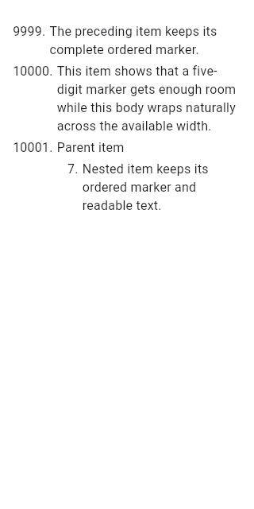

# Ordered Markdown marker bounds

The captures use Stroom's production `MarkdownWidget` and `buildMarkdownConfig` with a safe synthetic ordered list. The 10000 marker, natural body wrapping, a nested list, and a separate 1.8× text-scale state are visible.

- `ordered-markers-320x640-1x.png`: 320 × 640 CSS pixels, device scale 1, English (US), light theme, 1× text scale.

Widget coverage also checks the nested list at 1.8× text scale.

Capture with `flutter build web --release --target=tool/qa/markdown_list_marker_capture.dart`, serve `build/web` on port 8765, and run `python3 tool/qa/capture_markdown_list_marker.py`.

