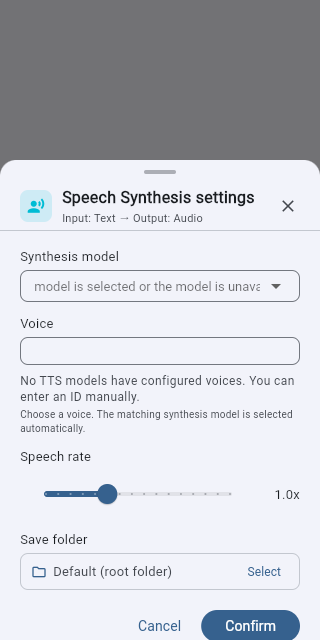

# Task Flow TTS manual voice guidance



This is a genuine Flutter Web release capture of the production
`BlockEditorDialog` with a local synthetic TTS provider fixture. The fixture
contains one TTS model with no configured voices, so the dialog uses its native
editable voice-ID field and displays the localized guidance below it. It makes
no provider request and uses no credentials.

Capture state: English (`en_US`), 320 × 640 CSS pixels, 1× device scale, 1×
text scale, light theme, no focused control, and keyboard closed. The width
forces the helper to wrap while the field remains a native text input.

Build and capture with:

```sh
flutter build web --release --no-pub --no-web-resources-cdn --target=tools/qa/task_flow_tts_voice_hint_capture.dart
python3 -m http.server 8875 --bind 127.0.0.1 --directory build/web
python3 tools/qa/task_flow_tts_voice_hint_capture.py
```

The fixture is defined in `tools/qa/task_flow_tts_voice_hint_capture.dart`.
