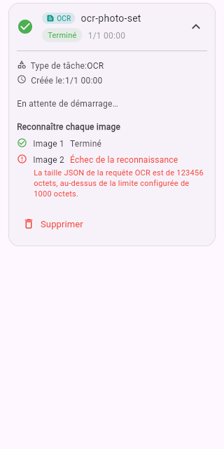

# OCR outcome rows at a narrow viewport

The capture shows the production `BackgroundTaskCard` in Flutter Web Release mode at 320 × 640 CSS pixels, DPR 1, French (France), 1× text scale, and the Material 3 light theme. The card is expanded to show one successful page and one failed page with a localized request-size error. The fixture exists only in memory; it makes no provider request and reads no account data. No control is focused and the software keyboard is closed. Chromium reported no page errors.

The screenshot is static because this change adds no motion.

Functional suite owner: `tests/pages/unified_task_list/background_task_card_test.dart` owns this widget behavior. The focused case, `OCR page outcomes reflow without losing labels or errors`, pumps the production card at 320 × 640 in Arabic with 2× text scaling, verifies the localized page index and failed status, verifies the full sanitized error summary, and asserts that Flutter reports no layout exception.
