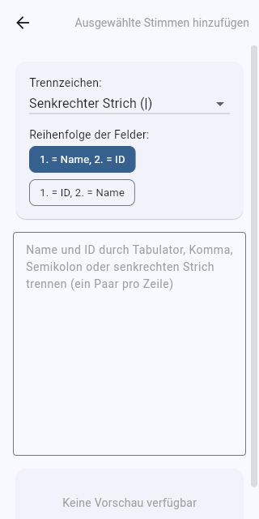

# Vertical voice separator at narrow width

At narrow widths, the separator label and native dropdown stack inside the
parse settings card. The dropdown uses the available card width, keeping the
complete selected value accessible through the control while preserving the
inline arrangement on wide screens.



This is a Flutter Web capture of the production `VoiceBatchAddPage`, with no
test-only text. It shows the real German “Senkrechter Strich (|)” selection at
320 × 640 CSS pixels, 1× device scale and 1× text scale. Locale is `de_DE`, the
theme is light, no control is focused, and the keyboard is closed. The page
uses an empty local voice list and makes no provider or synthesis calls.

Start the app and capture the selected separator with:

```sh
flutter run --no-pub -d web-server --web-hostname 127.0.0.1 --web-port 8874 --target tool/qa/voice_batch_separator_capture.dart
python3 tool/qa/voice_batch_separator_capture.py
```
