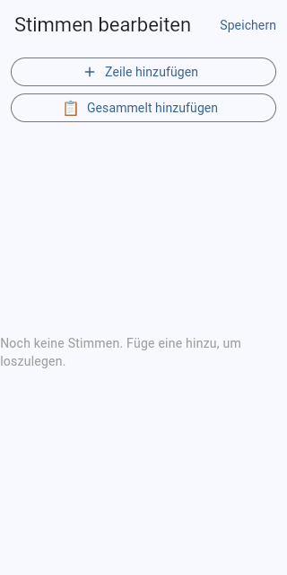
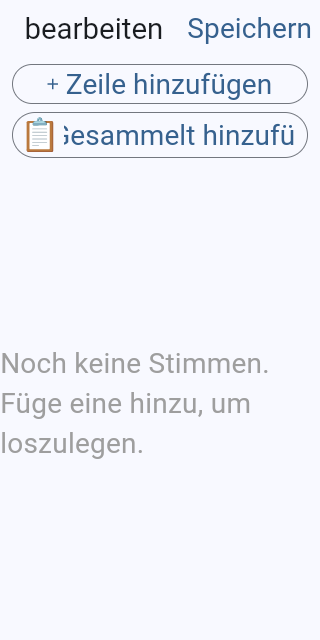

# Voice editor responsive actions

The voice editor action bar stacks its add-row and batch-add controls on narrow
viewports and when text scaling needs additional room. The wide layout retains
the existing inline arrangement. Button callbacks, native voice fields, and
label semantics remain unchanged.

- Primary capture: German voice editor actions at 320 × 640, 1× device scale,
  normal 1× text scale, and light theme.

  

- Supplemental capture: the same viewport and page with 2× text scale.

  

This is a genuine Flutter Web capture of `VoiceEditorPage` using an empty local
voice list. Both captures use German (`de_DE`), light theme, no focused
control, and keyboard closed. The primary capture uses normal 1× text scale;
the supplemental capture uses 2× text scale. No provider calls or voice
synthesis are made. Start the app with:

```sh
flutter run --no-pub -d web-server --web-hostname 127.0.0.1 --web-port 8874 --target tool/qa/voice_editor_actions_capture.dart
```

Then capture the screen with:

```sh
python3 tool/qa/voice_editor_actions_capture.py
```

The capture script saves both scales at 320 × 640 CSS pixels with a 1× device
pixel ratio.
