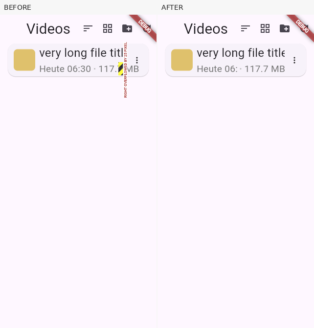

# File manager constrained-label audit

## Result

The shared file manager’s list file details row let the localized timestamp overflow its horizontal row beside the file size. On the production widget in Chromium at 320 × 640 CSS px and 1.6× text scale, de-DE rendered the timestamp beyond its slot and over the file size/action area. The shared row now gives timestamp and file size separate flexible slots and renders each through `ConstrainedText`. Full values remain available through the component’s marquee behavior; separators and the trailing menu keep their existing positions.

The file and folder names in both list and grid views already use `ConstrainedText`; the folder detail line wraps naturally. Breadcrumb labels use `ConstrainedText`, and the fixed back row’s custom front ellipsis retains the useful path suffix. File, folder, and sort menu labels fit at the tested narrow, large-text state. The file-folder subtitle is guarded by `file.folder != _currentFolder`, but list construction selects records from the exact `grouped[_currentFolder]` bucket; that branch is currently unreachable. Its text now uses a finite constrained slot if the grouping behavior changes. The responsive matrix also includes a long alternate folder path in the visible folder list. No other `FileManagerView` label change was needed.

## Call sites and verification

The four production page callers are `gallery_page.dart`, `video_gallery_page.dart`, `text_storage_page.dart`, and `tts_page.dart`. They provide localized titles and record-specific icon/thumbnail builders to the shared widget. This audit exercised the shared list and grid modes with the production localizations and a long file name, then opened the file, folder, and sort menus. Widget coverage used de-DE and pt-BR, 320 × 640 at 1.6× and 800 × 640 at 1×, in light and dark themes.

The baseline reproduced a RenderFlex overflow in the narrow, large-text list state. The automated widget test reports the framework’s diagnostic; Chromium capture confirms the visible overflow and the corrected layout. Existing breadcrumb tests also verify that front truncation retains the original path suffix and never splits surrogate pairs.

## Before/after comparison

The comparison uses the same `FileManagerView` file row, de-DE locale, 320 × 640 CSS px viewport, 1.6× text scale, light theme, list mode, and no user interaction. The before render came from the supplied baseline worktree at `a2c25d8b5f5d0e1c8f01cee06fc8e8b2d32fab76`; the after render came from this candidate.

The after-state timestamp and size use the shared component’s normal delayed horizontal reveal when their slots are too narrow. The playable preview shows that motion: [file-details-de-marquee.webm](file-details-de-marquee.webm).

## Capture method

Captured the production `FileManagerView` widget in Chromium from a temporary QA entrypoint using the app’s generated localizations and `galleryVideoPageTitle`. The entrypoint was used only for the isolated component render and removed after capture. The interactive preview uses 320 × 640 CSS px, device scale factor 1, de-DE, 1.6× text scale, light theme, and list mode.
