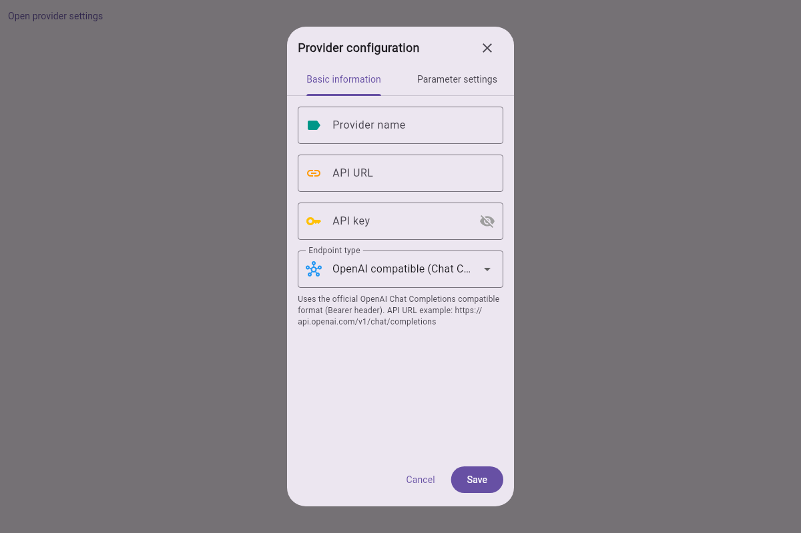
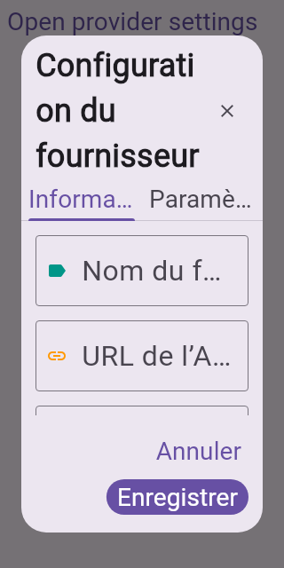
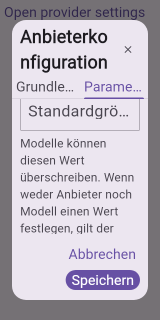
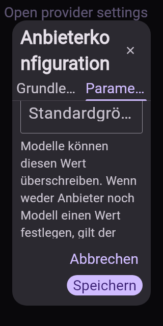

# Round 13 native form hints

The capture test renders the production provider settings dialog with empty in-memory fixture values. It captures a fitting English view at 1200 × 800 logical pixels with 1× text scale and a clipped French view at 320 × 640 logical pixels with 2× text scale. Both use the light Material 3 theme and device-pixel ratio 1. No field is focused and the software keyboard is closed. No account data or provider request is used. The test checks that all three basic provider hints use measured hint widgets linked to their native editable fields.

The French API endpoint hint is measured against its rendered one-line field slot to verify that it overflows at the narrow expanded-scale size. The fitting capture verifies that the basic provider fields remain visible in the wide normal-scale layout.

The OCR provider parameter tab is captured in German at 320 × 640 logical pixels and 2× text scale in both light and dark Material 3 themes. The request-size input is scrolled into view; the regression verifies its measured hint remains attached to the native numeric field with the `MiB` suffix. The existing file rename dialog also has a focused regression checking that its new-name hint is measured while the text field still accepts edits and preserves the caret.

Generate the screenshots with:

```sh
flutter test --no-pub --no-track-widget-creation --concurrency=1 --update-goldens tests/qa/round13_native_input_hints_capture_test.dart
```









The playable preview below captures the French provider API endpoint hint at 320 × 640 logical pixels, 2× text scale, DPR 1, and light Material 3. It shows the one-second start delay, horizontal travel, and the pause at the endpoint.

Generate the preview frames and encode them with:

```sh
CAPTURE_ROUND13_HINT_FRAMES=1 flutter test --no-pub --no-track-widget-creation --concurrency=1 --update-goldens tests/qa/round13_native_input_hints_capture_test.dart --plain-name 'provider hints fit at normal scale and reveal when clipped'
ffmpeg -y -framerate 5 -i docs/ui-constrained-text-qa/round13-form-hints-b/frames/frame-%02d.png -c:v libvpx-vp9 -crf 34 -b:v 0 -pix_fmt yuv420p docs/ui-constrained-text-qa/round13-form-hints-b/provider-hint-reveal-preview.webm
```

[Play the hint reveal preview](provider-hint-reveal-preview.webm)
