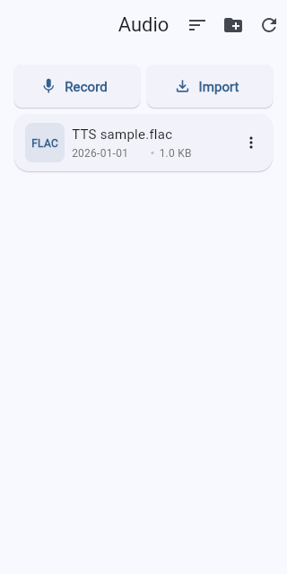
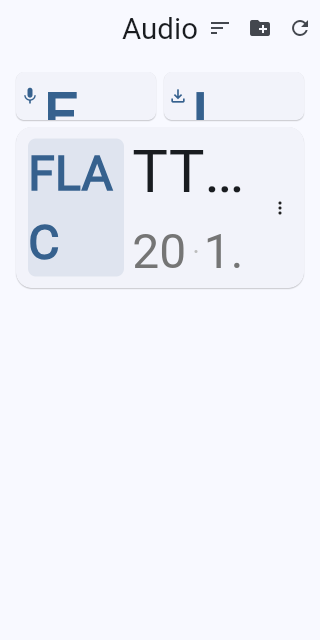

# TTS format badge at large text scales

The TTS file list keeps the FLAC format badge at its normal 44 dp size at 1×. At larger text scales, the badge width grows with the scaled label and the badge height grows as needed for wrapped text. The file name and trailing actions remain in their own row slots.

## Production captures

Captured the production `TtsPage` and shared `FileManagerView` in Chromium at 320 × 640 CSS px, device scale factor 1, light Material 3 theme, with a local FLAC fixture. The 1× English capture checks the fitting badge; the 4× French capture checks the enlarged state. The label is static, so no motion preview is needed.

| State | Capture |
|---|---|
| en-US, 1× |  |
| fr-FR, 4× |  |

Regenerate with `flutter run -d web-server --web-port 8897 -t tool/qa/tts_format_badge_capture.dart` and `python3 tools/qa/capture_tts_format_badge.py`.
