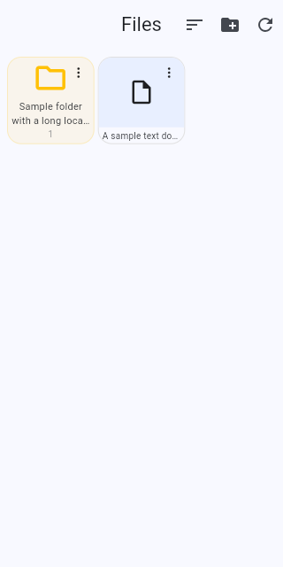

# File grid height capture



The production `FileManagerView` is shown at 320 × 640 CSS px in Chromium,
with a device scale factor of 1, en-US, light Material 3 theme, and 1× text
scale. The local in-memory fixture contains one root file, one folder, and a
file inside that folder. No control is focused and the browser keyboard is
closed. The capture entrypoint is
[`tools/qa/file_manager_grid_height_capture.dart`](../../../tools/qa/file_manager_grid_height_capture.dart);
the screenshot script is
[`tools/qa/capture_file_manager_grid_height.py`](../../../tools/qa/capture_file_manager_grid_height.py).

To recapture, build and serve the entrypoint with Flutter Web on port 8897,
then run the screenshot script:

```sh
flutter build web --release --target tools/qa/file_manager_grid_height_capture.dart
python3 -m http.server 8897 --directory build/web
python3 tools/qa/capture_file_manager_grid_height.py
```
