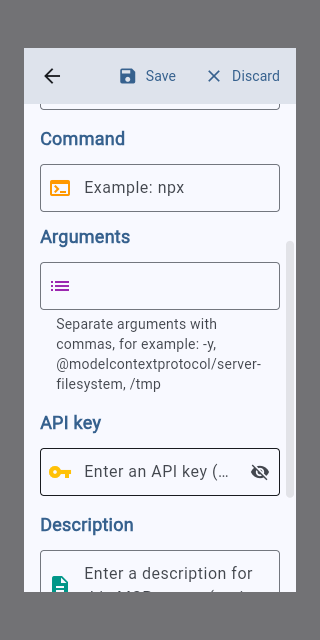

# MCP arguments instruction at 320 × 640

The MCP stdio configuration dialog keeps its arguments input native and displays
the complete localized argument instruction below the field with natural
wrapping. The capture uses the production dialog and an empty in-memory provider
fixture; it makes no provider request and contains no account data.

The screenshot is 320 × 640 CSS pixels at DPR 1, en-US, light theme, and 1× text
scale. No text field is focused and the software keyboard is closed. Capture it
with `python3 tool/qa/capture_mcp_arguments_hint.py`.
