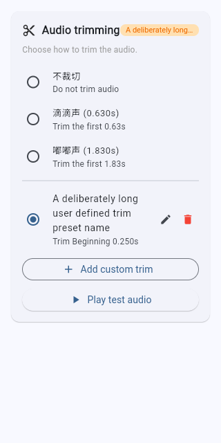

# Selected trim preset badge

The screenshot and motion preview show the production `TrimSection` with a
safe local user-defined preset whose name is long enough to exceed the header
badge's available width.

- Viewport: 320 × 640 logical pixels at device pixel ratio 1
- Locale: en-US
- Theme: light
- Text scale: 1×
- Focus: none
- Software keyboard: closed
- Static screenshot: reduced motion enabled, so the label remains at its
  initial visible edge
- Motion preview: system motion enabled, showing the shared reveal timing
- Data and network: local fixture preset only; no account data or network call

[Play the clipped label reveal preview](trim-preset-badge-motion-320x640.webm)

The fixture is `tool/qa/vertical_trim_badge_capture.dart`; the capture script is
`tool/qa/capture_vertical_trim_badge.py`.
