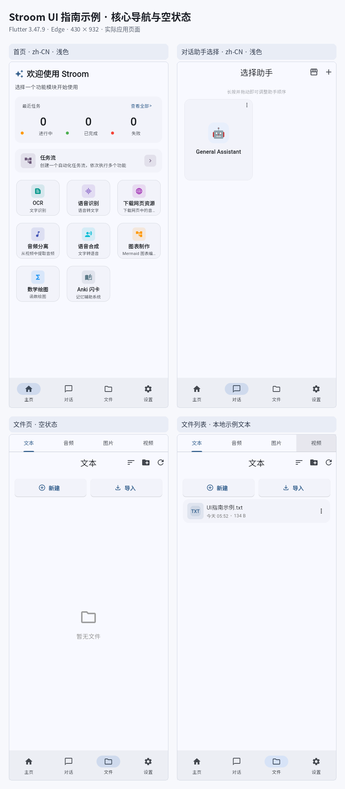
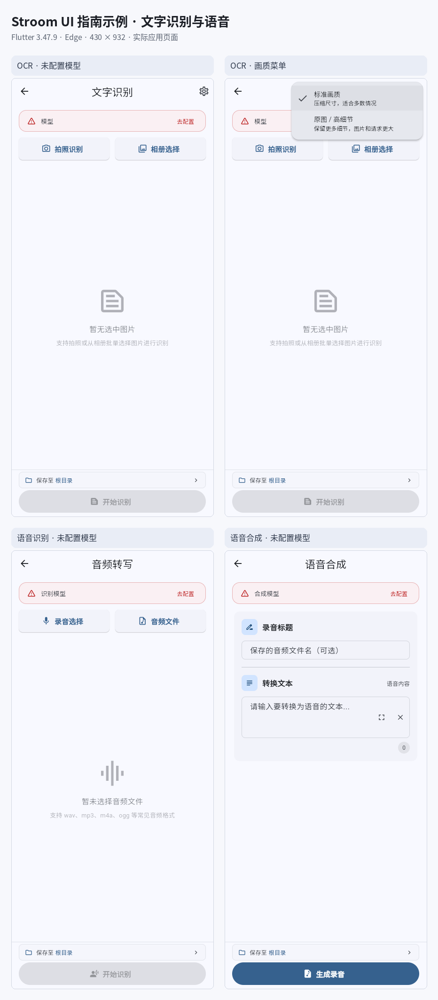
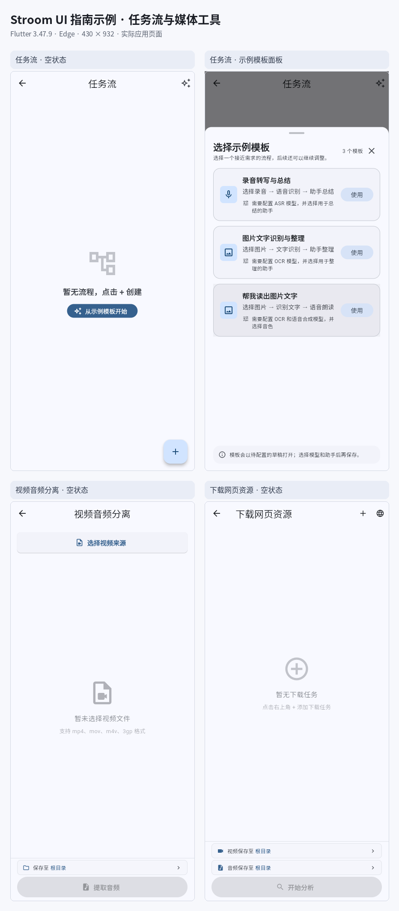
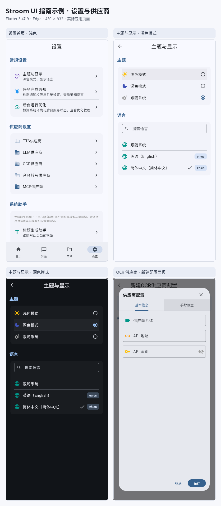
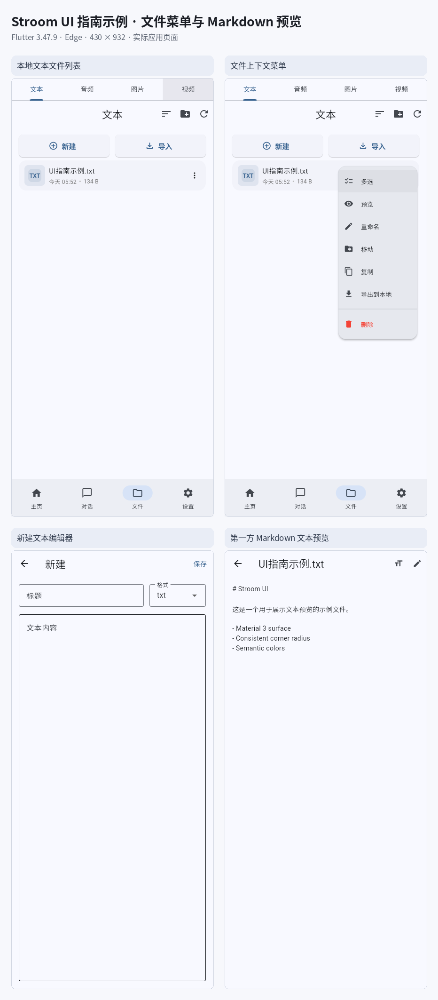

# Stroom UI guidelines

This guide documents the current first-party Flutter UI in `lib/` and the in-repository [`streaming_markdown` package](../packages/streaming_markdown/README.md). It records established patterns and review expectations; it is not a redesign specification. Search those roots and every affected call site before changing a component. The external math component is owned elsewhere and is outside this guide's implementation scope.

For menu and dropdown call sites, see the [popup and dropdown inventory](ui-popup-dropdown-inventory.md). Coding agents should also read the repository [`AGENTS.md`](../AGENTS.md); human contributors can start at [`CONTRIBUTING.md`](../CONTRIBUTING.md).

## 1. Design foundations

### Theme and color

Stroom uses Material 3. [`lib/application.dart`](../lib/application.dart) builds light and dark `ColorScheme`s from platform Dynamic Color when both dynamic schemes are available. If they are not, it falls back to `ColorScheme.fromSeed` with `Colors.blue`, including a dark blue-seeded scheme. Respect the selected light, dark, or system theme; don't replace this path with fixed light-only colors.

Use semantic `ColorScheme` roles for interface meaning: `primary` for the main action or selection, `onSurface` for primary text, `onSurfaceVariant` for supporting content, `outline` and `outlineVariant` for boundaries, `surface` and the `surfaceContainer*` family for layers, and `error` / `onError` for destructive or invalid states. Prefer these roles over literal gray, black, white, or red values.

Some non-semantic accents are intentional. Preserve folder amber, file/media-type colors, task status and category accents, and media controls that need contrast over imagery. Keep those scoped to the object or content they identify; do not reuse a category color as a general UI state color. Check contrast in both theme modes.

The app has no comprehensive first-party color-token layer: the Material color scheme is the shared semantic system, while some feature accents remain local to their components.

### Shape, spacing, borders, and elevation

These are component-role examples confirmed in the merged UI consistency changes. They are a guide to comparable surfaces, not a demand that every widget use one number.

| Role | Current pattern | Notes |
|---|---|---|
| Compact inset, icon plate, or nested control | 8 dp radius | Preserve smaller purpose-built geometry where density or content clipping calls for it. |
| Card, menu, or larger surface | 16 dp radius | Menus use the shared [`StroomMenuStyle`](../lib/widgets/stroom_menu_style.dart). Purpose-built capsules remain valid. |
| Layout rhythm | 4 dp based | Use the smallest step for compact local alignment and larger multiples for distinct groups. There is no global spacing-token class. |
| Provider helper-text gap | 8 dp | A merged comparable-control spacing correction. |
| Task-card header and major-detail separation | 12 dp | Keep 12 dp for these larger group boundaries; don't apply it to every row. |
| Dense inline/control inset | 2–4 dp gaps and 10 dp control insets | These are intentional compact exceptions, not values to normalize mechanically. |
| Static card elevation | 0 dp in both themes | Structure comes from surface and outline, not a default floating shadow. |
| Anki review card | 0.5 dp with `outlineVariant` | A subtle, feature-specific distinction. |
| Audio floating text-selection toolbar | 4 dp | It is an overlay and should read above page content. |

`lib/application.dart` applies zero elevation to the shared Material `CardThemeData` in light and dark themes. `lib/widgets/stroom_menu_style.dart` owns shared popup surface/shape treatment; other component radii and spacing are still set at their call sites. Search before introducing a new token or assuming a value is global. For a new repeated pattern, first establish the role and verify all current callers, then centralize only when the codebase supports a shared owner.

### Typography

Use the active theme's text roles for comparable UI: `bodyMedium` is 14 px for ordinary form text; `labelLarge` is 14 px for emphasized labels and buttons; and `titleMedium` is 16 px for block-editor headings. These are Flutter logical pixels, often referred to as dp in UI discussion. Keep numeric and monospaced content such as 13 px values where compact precision matters, plus other context-specific dense text. Do not remove the hierarchy by setting every text element to one size. Avoid hard-coded text color when a role can carry the semantic color.

The app does not define a complete custom global `textTheme`; read the nearest theme and current comparable widgets before adding local styles. Let text scaling and localization expand layout naturally.

## 2. App shell, navigation, and page layout

- Follow the responsive app shell in [`lib/pages/home_page_navigation.dart`](../lib/pages/home_page_navigation.dart) and the page's existing navigation structure. The app uses different navigation affordances across available widths/orientations; don't assume a phone-width bottom bar is the only layout.
- Keep page title, back navigation, and page-level actions in the established app bar/header region. Put actions that apply to a section or item at that scope rather than duplicating global actions in the body.
- Keep a page app bar's background color and visual color state unchanged while scrollable content moves beneath it. Use the established theme color consistently before and after scrolling; configure scroll-under styling so it does not introduce a color or tint change.
- Respect system safe areas, keyboard insets, scrollable content bounds, and platform-specific back behavior. Check portrait and landscape or narrow and wide layouts when the page supports them.
- Use consistent section spacing and alignment within one screen. Don't nest redundant cards, borders, and shadows around content already grouped by a parent surface.
- When adding a page, follow route and shell conventions in the existing page family; search for the route, title, navigation entry and all links to that page.

## 3. Shared components and common states

### Surfaces, rows, and grids

Use a card for a meaningful group, not as decoration around each control. Static cards are flat by default; use a semantic outline or surface layer where grouping needs a visible edge. Keep the interactive hit area and ink/ripple clip aligned to the visible shape. For dense rows use existing list tiles or shared row builders, maintain a clear primary/secondary text hierarchy, and place trailing controls consistently.

The file browser is a major grid/list example: [`lib/widgets/file_manager_view.dart`](../lib/widgets/file_manager_view.dart). Match thumbnail, text and menu spacing to the selected density and preserve the same action affordances when switching between grid and list views.

### Toolbars and actions

Give each region one clear primary action. Keep routine actions together and distinguish destructive actions with error semantics and, in menus, a divider when mixed with routine choices. Use an icon-only control only when its meaning is clear to assistive technology and an accessible tooltip/label is available. Avoid duplicate controls for the same action in a header and body unless the layout makes that distinction useful.

### Loading, empty, error, and selected states

Every data-backed page or component should have an intentional loading, empty, populated, and failure state where applicable. Use concise next-step copy in empty states, semantic supporting/error colors, and preserve layout stability while content changes. Show selection visibly and expose it semantically; don't signal state by color alone. Disable actions that cannot currently succeed and explain why when the reason is not obvious.

## 4. Forms and selection controls

Text fields, provider/model forms, OCR/ASR/TTS selectors, configuration editors, and task-flow editors should share label, helper, error, and spacing patterns with nearby forms. Prefer a persistent label over a placeholder-only field when users must remember what the value means. Keep validation next to the invalid input, preserve entered values when validation fails, and avoid resetting unrelated fields after a selection.

Use the control that matches the amount and type of choice: text input for free-form values, a switch for an immediate binary setting, radio/segmented choice for a small mutually exclusive set, chips for compact tags or filters, and a dropdown for a longer/selectable list. Tabs switch between peer content sections. Sliders are for continuous or ordered values and need a readable current value. Provide visible selected, disabled, focus, and validation states. Keep provider and model controls consistent across OCR, ASR, TTS, and chat configuration unless the workflow requires a genuine difference.

Check helper/error text at large text scale and in longer translations. Keep touch targets operable and don't make a text label and its nested control compete for the same tap.

## 5. Menus, dialogs, sheets, and feedback

The shared menu style is in [`lib/widgets/stroom_menu_style.dart`](../lib/widgets/stroom_menu_style.dart), attached to both themes in [`lib/application.dart`](../lib/application.dart). It uses `surfaceContainerHigh`, transparent surface tint, 16 dp corners, and a 0.5 dp `outlineVariant` stroke at 35% alpha; the Material 3 `DropdownMenu` style uses 8 dp elevation. Legacy `DropdownButton` widgets do not inherit a global menu radius, so the 33 current legacy call sites set the shared surface and radius locally. See the complete current [call-site inventory](ui-popup-dropdown-inventory.md).

Use a popup for a short set of contextual actions or a compact selection. Use a dialog when the user must decide or enter focused information before continuing. Use a bottom sheet for a larger contextual picker or content that benefits from a tall, scrollable surface. Use a snackbar for brief, non-blocking confirmation; persistent or actionable warnings need a more visible banner/inline state. Tooltips explain controls without replacing visible labels.

#### Responsive modal bottom-origin panels

Apply this Stroom convention to every component whose compact-screen presentation originates as a modal bottom sheet. At `shortestSide < 600 dp`, keep the panel anchored to the bottom, including in phone landscape. At `shortestSide >= 600 dp`, present that bottom-origin flow as a centered surface. A component already designed as a centered dialog stays centered at every size and is outside this conversion rule. These are Stroom conventions, not universal Material requirements.

- On wider viewports, cap the centered surface at `640 dp` and leave at least `24 dp` of side gutter (`width <= availableWidth - 48 dp`). A narrow phone sheet may use the full available width.
- Bound sheet and centered-surface height to `min(80% of the available viewport, 640 dp)`. Keep long content scrollable within that bound and respect system safe areas.
- Use a `28 dp` corner radius and `16 dp` content inset. Use theme-aware `surfaceContainerHigh` or `surface` roles, with a clear title and close or cancel action.
- Preserve the panel's expected selection, cancel, outside-tap, and back behavior, and expose selected state semantically.

The merged [emoji picker](../lib/pages/assistant/assistant_shared.dart) illustrates a bottom-origin flow adapting to a centered presentation on larger screens. It is an example, not the source of the dimensions above.

- Keep overlays anchored to the action or selection they belong to and inside the visible viewport, including short windows and keyboard-open states.
- Preserve expected outside-tap, back, escape, and selection dismissal behavior. Don't dismiss a destructive confirmation merely because a child control was tapped.
- Destructive actions use `error` semantics and are separated from routine actions when both share a menu. State the consequence in a confirmation dialog when the action is hard to reverse.
- Dialogs and sheets should have bounded content, a clear title, and an obvious close/cancel path. Test the narrowest supported layout and text expansion.
- The suggestion overlay in [`lib/pages/llm_model_config_shared.dart`](../lib/pages/llm_model_config_shared.dart) is a menu-like overlay; the overlay in [`lib/widgets/drag_sort_area.dart`](../lib/widgets/drag_sort_area.dart) is drag feedback and is not a menu.

## 6. Chat and rendered content

### Chat and composer

Chat page code is split across [`lib/pages/chat_page.dart`](../lib/pages/chat_page.dart) and adjacent `chat_page_*` files. Keep messages, assistant/topic controls, search/history, attachments, and composer actions aligned with their existing component boundaries. Distinguish user and assistant content without relying on color alone. Keep the composer usable with the software keyboard open, preserve draft text across supported navigation, and make send/stop/attachment states explicit. Verify long responses, streaming updates, and narrow layouts.

### First-party Markdown

Stroom's in-repository [`streaming_markdown` package](../packages/streaming_markdown/README.md) renders Markdown in chat and text preview. Its block and inline renderer sources include [headings](../packages/streaming_markdown/markdown_widget/lib/widget/blocks/leaf/heading.dart), [paragraphs](../packages/streaming_markdown/markdown_widget/lib/widget/blocks/leaf/paragraph.dart), [lists](../packages/streaming_markdown/markdown_widget/lib/widget/blocks/container/list.dart), [quotes](../packages/streaming_markdown/markdown_widget/lib/widget/blocks/container/blockquote.dart), [code blocks](../packages/streaming_markdown/markdown_widget/lib/widget/blocks/leaf/code_block.dart), [tables](../packages/streaming_markdown/markdown_widget/lib/widget/blocks/container/table.dart), [links](../packages/streaming_markdown/markdown_widget/lib/widget/blocks/leaf/link.dart), and [images](../packages/streaming_markdown/markdown_widget/lib/widget/inlines/img.dart).

Keep heading hierarchy legible, paragraphs and lists separated, quote/code/table blocks distinct from surrounding text, and links visibly interactive. Long code and wide tables must remain usable on narrow screens without forcing the whole page beyond its bounds. Images should preserve aspect ratio and have useful failure/placeholder behavior. Streaming updates should not cause avoidable jumps that lose the reader's position. This coverage includes Stroom's first-party Markdown renderer only; the external math component's rendering and source are explicitly excluded.

## 7. Feature-family guidance

These links are orientation points in the current source tree, not a claim that a single file owns the entire feature. Search the full `lib/` tree for additional shared widgets and call sites before editing.

| Feature family | Current examples | Consistency checks |
|---|---|---|
| Home and app shell | [`home_page_navigation.dart`](../lib/pages/home_page_navigation.dart), `home_page_home_content.dart` | Responsive navigation, module cards, page-level actions, empty/recent states. |
| Chat, assistants, topics, search, history | [`chat_page.dart`](../lib/pages/chat_page.dart), `topic_selection_page.dart`, `conversations_page.dart`, `assistant_selection_page.dart` | Message/composer states, search/filter, selection, topic/history menus, long/streaming content. |
| Files, text, media, gallery, editor, viewers | [`file_manager_view.dart`](../lib/widgets/file_manager_view.dart), `text_storage_page.dart`, `video_gallery_page.dart`, `markdown_extensions.dart` | Grid/list parity, file type accents, selection, preview/editor errors, media overlays. |
| OCR | [`ocr_page.dart`](../lib/pages/ocr_page.dart), `ocr_model_config_page.dart` | Unconfigured and configured providers, model selection, validation, result/error states. |
| ASR and recording | [`asr_page.dart`](../lib/pages/asr_page.dart), `asr_model_config_page.dart` | File/recording selection, progress/cancel, model settings, permissions and errors. |
| TTS and voice editing | [`tts_create_page.dart`](../lib/pages/tts_create_page.dart), `voice_batch_add_page.dart` | Voice/model selection, preview/playback, batch progress, dense controls. |
| Audio separation and playback | [`audio_separation_page.dart`](../lib/pages/audio_separation_page.dart), `audio_separation_shared.dart` | Floating selection controls, waveform/player contrast, progress and output actions. |
| Task list and Task Flow | [`unified_task_list_page.dart`](../lib/pages/unified_task_list_page.dart), [`task_flow_list_page.dart`](../lib/task_flow/pages/task_flow_list_page.dart), [`block_editor_dialog.dart`](../lib/task_flow/widgets/block_editor_dialog.dart) | Status/category accents, hierarchy of flow cards, editor validation, run states. |
| Providers, models, MCP | [`provider_config_page.dart`](../lib/pages/provider_config_page.dart), [`model_config_page.dart`](../lib/pages/model_config_page.dart), [`mcp_server_config_page.dart`](../lib/pages/mcp_server_config_page.dart) | Form/help/field patterns, dropdown consistency, test/connection and validation states. |
| Settings, backup, notifications, logs | [`settings_page.dart`](../lib/pages/settings_page.dart), [`notification_settings_page.dart`](../lib/pages/notification_settings_page.dart), [`backup_restore_page.dart`](../lib/pages/backup_restore_page.dart), [`log_viewer_page.dart`](../lib/pages/log_viewer_page.dart) | Section headings, grouped settings, destructive/restore confirmation, dense log readability. |
| Anki | [`anki_page.dart`](../lib/pages/anki_page.dart) | Review-card surface, queue/empty/loading states, answer and navigation actions. |
| CatCatch | [`catcatch_page.dart`](../lib/pages/catcatch_page.dart), [`catcatch_policy_menu.dart`](../lib/task_flow/widgets/catcatch_policy_menu.dart) | Capture/permission states, policy choices, category semantics and progress. |
| Browser, downloads, cookies | [`browser_page.dart`](../lib/pages/browser_page.dart), [`browser_cookies_page.dart`](../lib/pages/browser_cookies_page.dart), [`download_manager.dart`](../lib/catcatch/engine/download_manager.dart), [`browser_cookie_service.dart`](../lib/services/browser_cookie_service.dart) | Navigation/toolbar density, download progress, permission and cookie settings. |
| Mermaid and charts | [`mermaid_chart_page.dart`](../lib/pages/mermaid_chart_page.dart), [`mermaid_render_widget.dart`](../lib/widgets/mermaid_render_widget.dart) | Editor/preview split, code density, render errors, viewport fit and mode selection. |

### Representative captured screens

These contact sheets show selected real screens from the current Flutter Web build; they are examples, not a complete screen inventory. Each panel is an actual Flutter-rendered app screenshot placed beside its caption, with no generated or redrawn UI. Captures used Flutter 3.47.9 / Dart 3.13.7, Microsoft Edge 142, a 430 × 932 viewport, and zh-CN. The isolated browser profile had no restored account data. OCR, ASR, and TTS providers were unconfigured, and no provider request or API call was made. The settings sheet includes light and dark appearance examples; the other examples are light theme.

| Examples | Captured screens |
|---|---|
| Home, assistant selection, empty file state, and a local sample text file list. |  |
| Unconfigured OCR, the OCR image-quality popup, unconfigured ASR, and unconfigured TTS. |  |
| Empty Task Flow, its built-in template sheet, and empty audio-separation and web-download states. The task list is not pictured because the isolated fresh web profile could not restore its task history. |  |
| Settings overview, light and dark appearance, and a new OCR provider editor. The editor is unsaved; no provider request was made. |  |
| Local sample text list, its actual file popup menu, blank new-text editor, and first-party Markdown preview. |  |

## 8. Accessibility, localization, and platform behavior

- Label icon buttons and custom controls for screen readers; preserve logical focus order and announce validation, progress, selection, and result changes.
- Keep keyboard navigation, visible focus, activation keys, back/escape behavior, and focus return when a dialog or menu closes. Don't trap keyboard focus in a popup.
- Support text scaling without clipped controls or hidden actions. Allow localized labels to wrap and scroll rather than truncating important actions. Use generated localization resources instead of adding UI strings in only one locale.
- Meet adequate text and control contrast in light and dark themes, including disabled states and content over images. Pair color with text, icon, shape, or position for status meaning.
- Respect safe areas and platform conventions for keyboard, navigation, dialogs, window resizing, and pointer/hover interaction. A mobile-only interaction is not sufficient when a feature is available on desktop/web.

## 9. Contributor workflow and review checklist

Before changing a UI pattern:

1. Search `lib/` and `packages/streaming_markdown/` for the widget, theme role, text, radius/spacing pattern, and all call sites. Search tests only to understand existing coverage; don't mistake test fixtures for production UI.
2. Identify the shared component or theme owner. Reuse it when it fits; if a shared component must change, inspect every caller and preserve legitimate per-feature differences.
3. Update all affected screens, not only the first matching call site. Keep feature accents, compact dense controls, media overlays, and purposeful capsule shapes when their role warrants an exception.
4. Check light and dark themes, the relevant narrow/wide or portrait/landscape state, long/localized text, and keyboard/overlay behavior for the affected feature.
5. Validate changed code with the repository's relevant checks. For visual changes, add a genuine representative screenshot and state description to the pull request when practical; never use unrelated fixtures as screen captures.
6. Keep external math component ownership out of changes. Update this guide or the popup/dropdown inventory when a shared convention or call-site census changes.

For each UI pull request, record impacted screens/components, the shared-widget and call-site search performed, validation, and the representative light/dark or layout state checked. Use the checklist in [`.github/pull_request_template.md`](../.github/pull_request_template.md).
