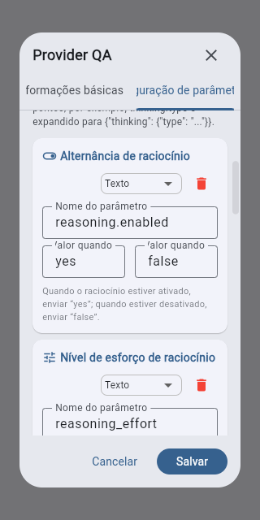
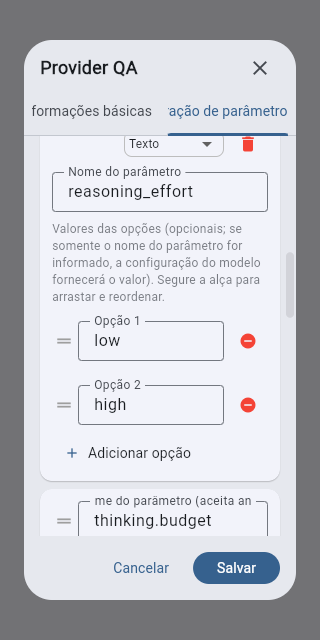

# Provider field label QA capture

These artifacts show the production `ProviderSettingsPanel` component in Flutter Web release mode, rendered by Chromium. A temporary local entrypoint opened the real `showProviderSettingsPanel` with a local provider configuration; no test font, mock field, or provider network request was used.

## Capture state

- Viewport: 320 × 640 logical pixels at device scale factor 1.
- Locale: Portuguese (Brazil), `pt-BR`.
- Theme: light Material 3; system text scale 1.0; reduced motion not requested.
- Screen: provider settings, “Configuração de parâmetros” tab, scrolled to the reasoning toggle fields.
- Focus and editing: the “Valor quando desativado” field is focused and contains `false`; Chromium's Flutter text input host is active and the caret is visible. Desktop Chromium has no on-screen software keyboard.
- Label behavior: the longer on/off labels are clipped by their measured finite field slots and reveal horizontally. “Nome do parâmetro” fits and remains stationary. The preview begins with the narrow viewport after a resize from 1200 × 800, so it includes the initial still interval before movement and the endpoint pause.

## Artifacts

[Play the 9-second clipped-label motion preview](images/provider-field-label-motion-320x640-pt-BR.webm)

## Provider reasoning row reflow

The narrow provider configuration tab now places each reasoning-card title above its type and delete controls, and places additional-parameter controls below the full-width native name field. No field is focused and the keyboard is closed in these captures; the controls retain their native dropdown, delete, edit, and drag behavior. The screenshots use the real `ProviderSettingsPanel` in Flutter Web release mode with the same 320 × 640 logical-pixel, 1×, light `pt-BR` state.

### Before

### After

Repeatable capture entry point: `tools/qa/provider_reasoning_reflow_capture.dart`.
